<div align="center">

<!-- ═══════════════ TITLE SCREEN ═══════════════ -->


<a href="https://git.io/typing-svg">
  
</a>

<br>

<a href="https://github.com/SK-Rudra"></a>
<a href="https://www.linkedin.com/in/shahriar-karim-rudra-20ab08315/"></a>
<a href="mailto:s.k.rudra1502@gmail.com"></a>


</div>

<!-- ═══════════════ PLAYER 1 ═══════════════ -->




I'm a Computer Science undergraduate at **BRAC University**, specializing in **Machine Learning, NLP and Systems Architecture**. I build intelligent systems that solve real problems, with a particular focus on **low-resource language processing** and robust data pipelines.

Beyond text models, I'm deep into full-stack integration, algorithmic performance and interactive 3D rendering. I care about tools that are carefully engineered and actually useful, not just technically complicated.

<details>
<summary><b>▶ OPEN <code>player.py</code></b></summary>

```python
class Developer:
    def __init__(self):
        self.name = "Shahriar Karim Rudra"
        self.institution = "BRAC University, Dhaka"
        self.focus = ["NLP", "LLMs", "Machine Learning", "3D Graphics"]
        self.thesis = "Bangla PII Detection & Redaction (BanglaBERT + NER)"

    def get_principle(self):
        return "Ship fewer things, ship them exceptionally well."
```

</details>


<!-- ═══════════════ QUEST LOG ═══════════════ -->


| | QUEST | TYPE | STATUS |
|:-:|:--|:-:|:-:|
| 🗡️ | **Bangla PII Detection & Redaction** <br><sub>BanglaBERT + NER + regex layer that finds and redacts personal data in Bangla text</sub> | `MAIN QUEST` | `▶ IN PROGRESS` |
| 🎵 | [**Umbra**](https://github.com/SK-Rudra/umbra) <br><sub>Open-source Discord music bot · Node.js, Discord.js, FFmpeg · 42 tests, 0 vulnerabilities at release</sub> | `SIDE QUEST` | `★ CLEARED v0.1.0` |
| ✉️ | [**EverDear**](https://github.com/SK-Rudra/EverDear) <br><sub>Privacy-first digital correspondence platform · Next.js, NestJS, PostgreSQL, Prisma</sub> | `SIDE QUEST` | `▶ IN PROGRESS` |
| ☀️ | **ChhayaPath** <br><sub>Time-aware pedestrian routing to reduce sun exposure in Dhaka</sub> | `RESEARCH` | `★ EXPO 2026` |
| 📊 | **Bangla Sentiment Classifier** <br><sub>TF-IDF + Logistic Regression baseline for Bangla text</sub> | `TRAINING` | `★ CLEARED` |
| 🏫 | **CareOS** <br><sub>Multi-tenant SaaS for childcare management · Next.js on Vercel</sub> | `CO-OP` | `★ DEPLOYED` |

<!-- TODO: add repo links for ChhayaPath, the Sentiment Classifier and CareOS -->


<!-- ═══════════════ INVENTORY ═══════════════ -->


<div align="center">

**⚔️ WEAPONS** &nbsp;·&nbsp; <sub>ML / NLP</sub><br>


**🛡️ ARMOR** &nbsp;·&nbsp; <sub>WEB / APPS</sub><br>


**🧪 ITEMS** &nbsp;·&nbsp; <sub>DATA / TOOLS</sub><br>


</div>


<!-- ═══════════════ ARCADE ═══════════════ -->


<div align="center">
<sub>my contribution graph, being eaten by Pac-Man (regenerated daily)</sub><br><br>
<picture>
  <source media="(prefers-color-scheme: dark)" srcset="https://raw.githubusercontent.com/SK-Rudra/SK-Rudra/output/pacman-contribution-graph-dark.svg">
  <source media="(prefers-color-scheme: light)" srcset="https://raw.githubusercontent.com/SK-Rudra/SK-Rudra/output/pacman-contribution-graph.svg">
  
</picture>
</div>


<!-- ═══════════════ SAVE POINT ═══════════════ -->


<div align="center">

Open to **NLP / LLM engineering** roles, research collaborations and interesting Bangla-language problems.


<br><br>


</div>
