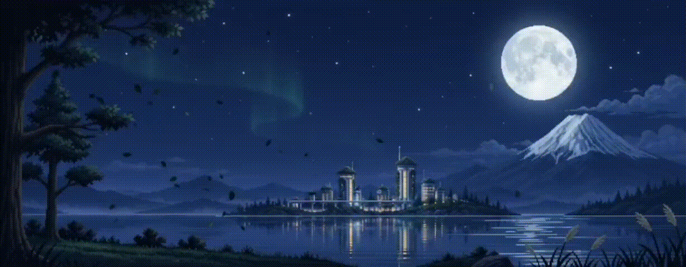
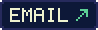
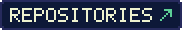
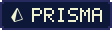
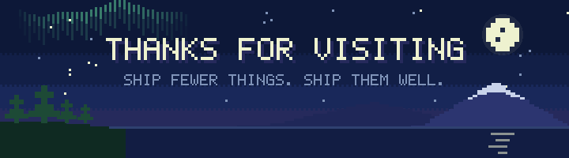

<!--
  Design system (all assets generated by scripts/build_assets.py)
  night #0d1838 · indigo #262a5c · aurora #5ccf96 · moon #eef2cf · haze #7f93b8
  Palette sampled from assets/banner.gif. Headers, name and footer swap
  between dark/light versions automatically; chips are dark on both themes.
-->

<div align="center">



<br><br>

<picture>
  <source media="(prefers-color-scheme: dark)" srcset="https://raw.githubusercontent.com/SK-Rudra/SK-Rudra/main/assets/name-dark.svg">
  
</picture>

<p>CSE&nbsp;student at BRAC&nbsp;University&nbsp; · &nbsp;aspiring AI/ML&nbsp;engineer&nbsp; · &nbsp;Dhaka</p>

<a href="https://www.linkedin.com/in/shahriar-karim-rudra-20ab08315/"></a>&nbsp;
<a href="mailto:s.k.rudra1502@gmail.com"></a>&nbsp;
<a href="https://github.com/SK-Rudra?tab=repositories"></a>

</div>

<br>

<h3>
<picture>
  <source media="(prefers-color-scheme: dark)" srcset="https://raw.githubusercontent.com/SK-Rudra/SK-Rudra/main/assets/headers/about-dark.svg">
  
</picture>
</h3>

I'm a Computer Science and Engineering student at **BRAC University**, working toward a career as an **AI/ML engineer**. Most of my time goes into machine learning and NLP, especially **Bangla NLP** and **privacy-preserving AI**. I'm also drawn to software engineering and data science.

I care about continuous learning, meaningful projects, clean engineering and research.

<details>
<summary><sub>&nbsp;open <code>developer.py</code></sub></summary>

```python
class Developer:
    def __init__(self):
        self.name = "Shahriar Karim Rudra"
        self.institution = "BRAC University, Dhaka"
        self.focus = ["Machine Learning", "NLP", "Bangla NLP", "Privacy-preserving AI"]

    def get_principle(self):
        return "Ship fewer things, ship them exceptionally well."
```

</details>

<br>

<h3>
<picture>
  <source media="(prefers-color-scheme: dark)" srcset="https://raw.githubusercontent.com/SK-Rudra/SK-Rudra/main/assets/headers/now-dark.svg">
  
</picture>
</h3>

- **Research:** ChhayaPath, time-aware pedestrian routing that reduces sun exposure in Dhaka. Selected for Inter University Research Expo 2026.[ChhayaPath](https://github.com/SK-Rudra/ChhayaPath)
- **Practice:** data structures and algorithms through [NeetCode 150](https://github.com/SK-Rudra/NeetCode150).

<br>

<h3>
<picture>
  <source media="(prefers-color-scheme: dark)" srcset="https://raw.githubusercontent.com/SK-Rudra/SK-Rudra/main/assets/headers/projects-dark.svg">
  
</picture>
</h3>

&nbsp; **[Umbra](https://github.com/SK-Rudra/umbra)**&nbsp; <sub>v0.1.0</sub><br>
A self-hosted Discord music bot that only plays legally streamable sources.<br>
<sub>JavaScript · Node.js · Discord.js · FFmpeg</sub>

&nbsp; **[EverDear](https://github.com/SK-Rudra/EverDear)**&nbsp; <sub>in progress</sub><br>
Private digital letters with photos and video, shared through secure links, plus a moderated anonymous wall.<br>
<sub>TypeScript · Next.js · NestJS · PostgreSQL</sub>

&nbsp; **[3D Intelligent Traffic Simulator](https://github.com/SK-Rudra/3D-Intelligent-Traffic-Simulator)**<br>
A real-time 3D intelligent traffic simulation in Python and OpenGL.<br>
<sub>Python · PyOpenGL · GLUT</sub>

<br>

<h3>
<picture>
  <source media="(prefers-color-scheme: dark)" srcset="https://raw.githubusercontent.com/SK-Rudra/SK-Rudra/main/assets/headers/stack-dark.svg">
  
</picture>
</h3>

<sub>AI / ML</sub><br>


<sub>WEB</sub><br>


<sub>DATA & TOOLS</sub><br>




<br>

<h3>
<picture>
  <source media="(prefers-color-scheme: dark)" srcset="https://raw.githubusercontent.com/SK-Rudra/SK-Rudra/main/assets/headers/arcade-dark.svg">
  
</picture>
</h3>

<sub>A pixel snake eats a year of my contributions. Regenerated daily by a GitHub Action.</sub>

<picture>
  <source media="(prefers-color-scheme: dark)" srcset="https://raw.githubusercontent.com/SK-Rudra/SK-Rudra/output/snake-dark.svg">
  
</picture>

<br><br>


